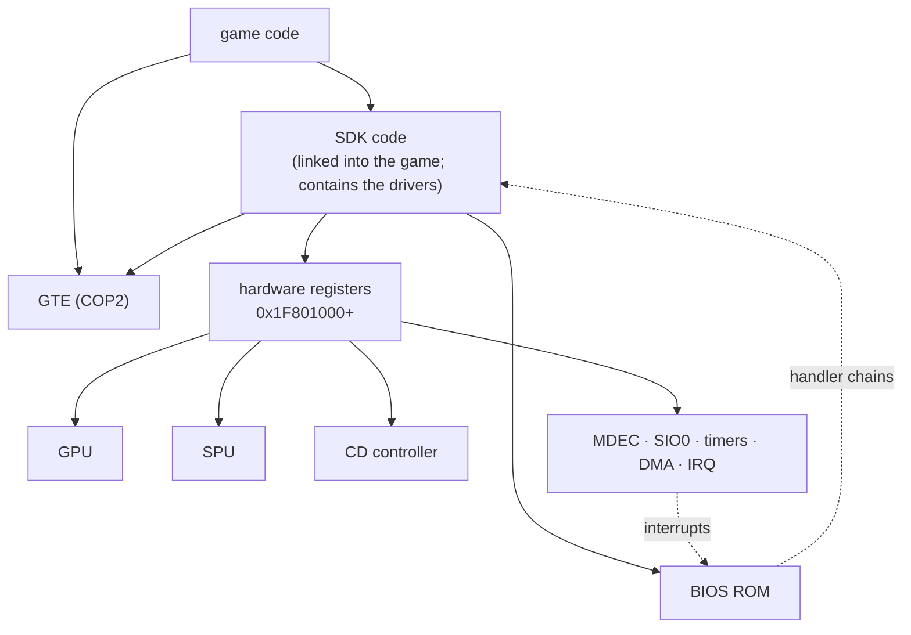
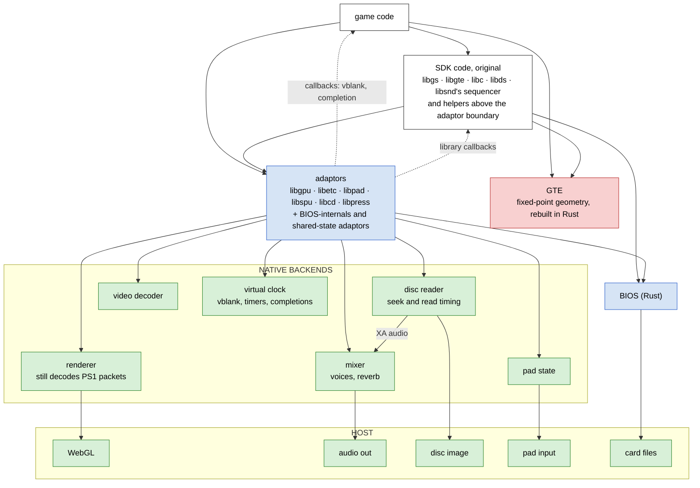
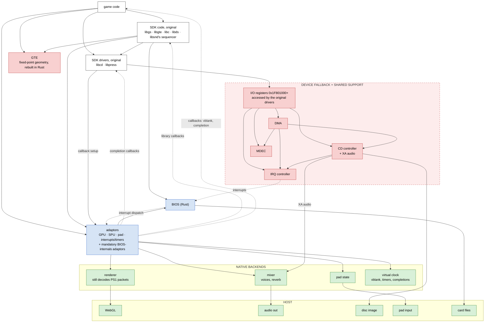

# What is emulated: the layers

The build modes in the [unified adaptor layer plan](../plans/unified-adaptor-layer/README.md):
prefer native software interfaces, then fall back to hardware registers
one chip at a time. These are architectural configurations, not snapshots
of btn or bof4. See [adaptor-layer-status.md](adaptor-layer-status.md) for
current game coverage, function counts, and remaining work.

| Colour | Meaning |
|---|---|
| white | original code (game or SDK), compiled to wasm; no CPU is emulated |
| blue | reimplemented in Rust at a software interface (adaptors, BIOS) |
| red | reproduced hardware semantics (register-level devices, GTE) |
| green | native backends and host services |

Solid arrows are calls and accesses. Dotted arrows are interrupts and
callbacks, which go up.

## The PS1

## What is an adaptor?

An adaptor is a Rust replacement for an SDK function at a validated
software boundary. Instead of running the original driver through hardware
registers, it calls the native core directly: submit draw packets, mix
voices, read sectors, decode video, or sample pad state. It preserves what
the code above that boundary observes: return values, buffers, shared
library state, callbacks and timing at sync points. The same adaptor serves
every game that uses that function; it is not a per-game shortcut.

Only the boundary is replaced. Code above it stays original: libgs builds
packets, libsnd sequences music, libds drives libcd, and helpers can remain
where they do not reach past the adaptors. Adaptors for one chip share one
state model, including calls from different libraries.

There are two kinds:
- **Hardware adaptors** replace SDK code that drives a chip. Missing or
  unvalidated coverage makes that whole chip fall back to its device model.
- **BIOS-internals adaptors** replace code that patches or reads Sony BIOS
  internals (parts of libapi, libcard and libmcx). These are mandatory:
  the BIOS is Rust, so there is no Sony ROM to fall back to.

**The GTE is fixed-point geometry, rebuilt in Rust.** COP2 instructions and
`gte_*` macros call `psx-gte`, a maths library retaining the PS1's register,
rounding, saturation and flag behaviour. It stays red because it reproduces
hardware semantics, but runs as compiled maths alongside the game—not as
an emulated CPU. This is unchanged by adaptor coverage.

## Full adaptor build

Every chip the game uses has complete, validated adaptor coverage. No
original driver reaches the I/O registers. The renderer still understands
PS1 packets, the mixer still implements voices and reverb, and the drive
still has seek/read timing; bypassing register protocols does not remove
those behaviours. Adaptors and device models use the same underlying cores.

A full build can assert `--check no-io`: any guest register access is a
coverage bug, not an invitation to mix drivers. Phase 1 targets this mode
for btn and bof4; phase 2 extends coverage to the rest of PsyQ 4.7.

## Partial adaptor build: graceful degradation

If anything reaches a chip outside its validated adaptor set, **the whole
chip falls back**, not just that function or library. Its original SDK
drivers run over the register-level device. Other chips keep their native
paths; a chip never has an adaptor driver and an original driver competing
for its state.

Here, CD and MDEC have fallen back. GPU, SPU, pads and the SDK's
interrupt/timer layer remain adapted. The fallback devices retain the DMA
and IRQ support they need; adapting the SDK's dispatcher does not erase
shared controller state. This is an illustrative configuration, not a
particular game's current build.

As coverage shrinks, more chips move behind the register bus. At the far
end, all hardware-facing SDK code runs original over device models—but
the game and SDK are still compiled, never CPU-interpreted. The degradation
is in how much hardware must be modelled, not a deliberate loss of game
behaviour or output quality. BIOS-internals adaptors and the Rust GTE stay
in every mode.

The build reports each chip's mode and fallback reason in `build.json`;
`game.toml` can require chips to stay native, making unexpected degradation
a build error. `--device <chips|all>` forces fallback for conformance and
replays; run reports count register accesses per chip.
