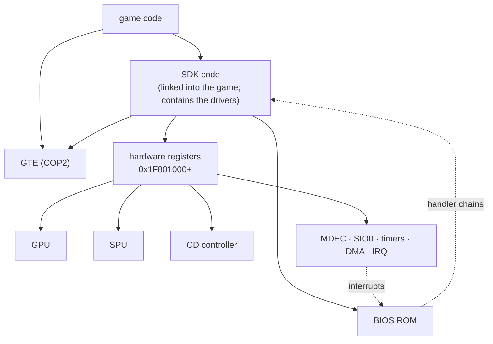
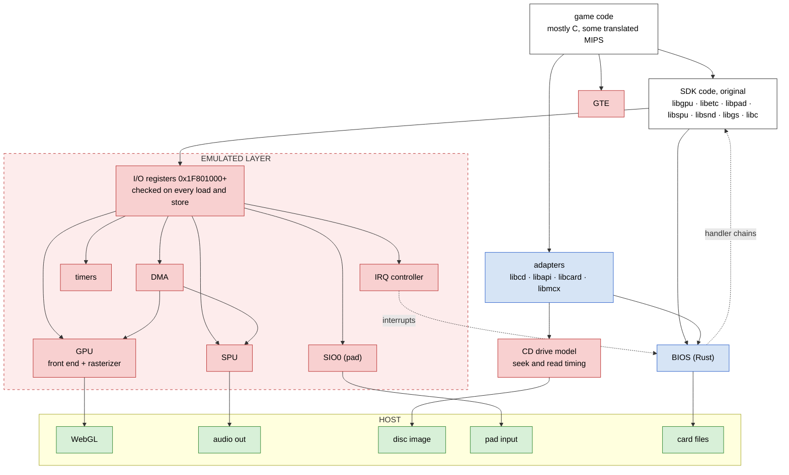
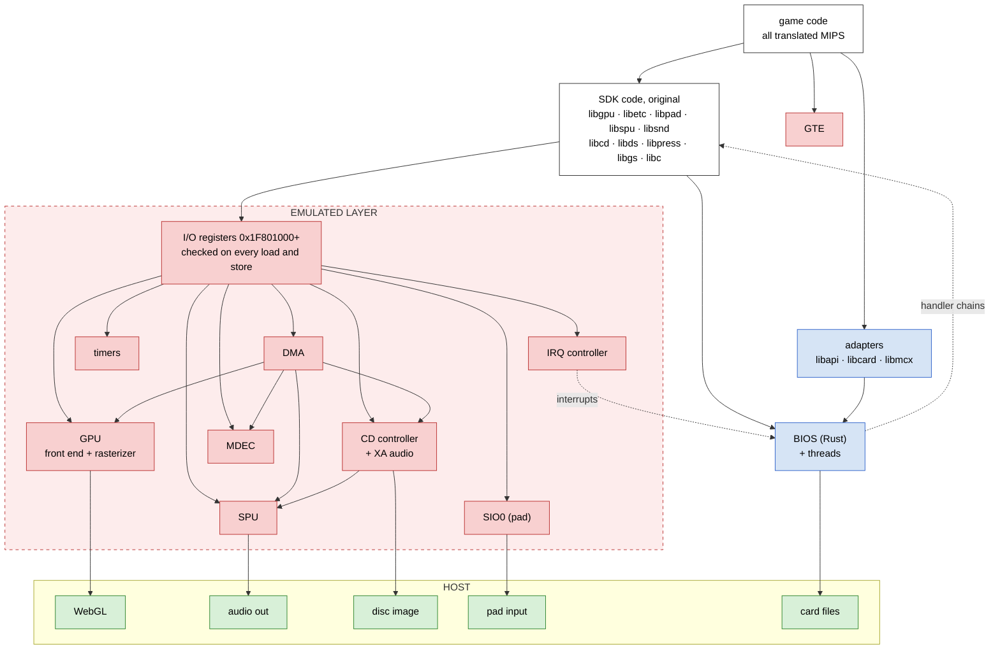
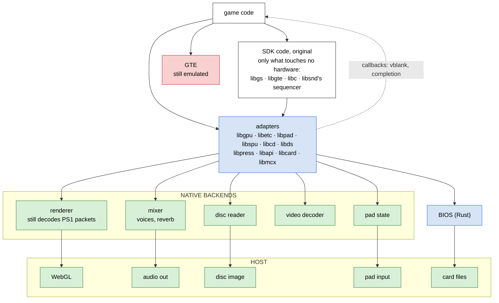

# What is emulated: the layers

As of 2026-10-29. See [status-btn-vs-bof4.md](status-btn-vs-bof4.md) for
function counts and the decisions that moved the boundary.

| Colour | Meaning |
|---|---|
| white | original code (game or SDK), compiled to wasm; no CPU is emulated |
| blue | reimplemented in Rust at a software interface (adapters, BIOS) |
| red | emulated hardware |
| green | native host backends |

Solid arrows are calls and accesses. Dotted arrows are interrupts and
callbacks, which go up.

## The PS1

## Today: btn

## Today: bof4

No CD adapters: libcd, libds and libpress run as original code over the
emulated CD controller and MDEC.

## An adapter build

Every SDK function that touches hardware gets an adapter; the rest of the
SDK still runs as original code. Nothing reaches the I/O registers, so a
build with no I/O bus traps on any access: the claim is checkable per
game. The cost is a validated adapter set per SDK version.

